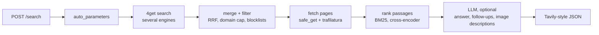

# Local Search API

**A self-hosted, Tavily-compatible web search API for LLM apps and agents, built on [4get](https://git.lolcat.ca/lolcat/4get).**

It searches the web through your own 4get instance, fetches and cleans the result pages, ranks the passages that best answer the query, and can write an answer with an LLM. The request and response format follows the Tavily API, so existing Tavily clients work by changing the base URL.


---

## Contents

- [Features](#features)
- [How it works](#how-it-works)
- [Quickstart](#quickstart)
- [Usage](#usage)
- [API reference](#api-reference)
- [Configuration](#configuration)
- [Data files](#data-files)
- [Running the tests](#running-the-tests)
- [Project layout](#project-layout)
- [Limitations](#limitations)

## Features

- **Tavily-compatible** `POST /search` and `POST /extract`; the official `tavily-python` client works unchanged.
- **Multi-engine search** through 4get (DuckDuckGo, Startpage, Qwant, Yandex, Marginalia, Brave), with automatic fallback when an engine is blocked or rate-limited.
- **Result merging** with reciprocal rank fusion and at most 3 results per domain.
- **Safe page fetching**: every URL and every redirect hop is checked; private, loopback and link-local addresses are refused, with DNS pinning against rebinding.
- **Main-text extraction** with trafilatura, as plain text or markdown.
- **Passage ranking**: pages are split into chunks and scored with BM25; `search_depth="advanced"` adds a cross-encoder rerank (runs locally, no API needed).
- **LLM features** (optional, any OpenAI-style endpoint): answers grounded in the results, follow-up questions, and image descriptions with a vision model.
- **`auto_parameters`**: guesses `topic`, `time_range` and `search_depth` from the query.
- **Filters**: include and exclude domains, time ranges and dates, exact phrases, spam blocklists.

## How it works



1. **Search**: the query (plus `site:` operators for domain filters) goes to 4get, which queries the upstream engines. Engines that fail are cooled down, and the next one is tried.
2. **Merge and filter**: results from all queries are merged with reciprocal rank fusion, deduplicated by canonical URL, and filtered by domain, date and blocklists.
3. **Fetch**: candidate pages are downloaded in parallel within a per-request time budget, and the main text is extracted.
4. **Rank**: each page is chunked; the best chunks become the result's `content`, and the page score blends text relevance with the engines' ranking.
5. **Answer** (optional): the top results are sent to an LLM as numbered sources.

## Quickstart

### Requirements

- Python 3.13+ and [uv](https://docs.astral.sh/uv/)
- A running **4get** instance with its API reachable, for example at `http://localhost/api/v1`. Follow the install guide in the [4get repository](https://git.lolcat.ca/lolcat/4get).
- Optional: an OpenAI-compatible chat endpoint, such as a local Ollama or llama.cpp server, or a hosted gateway.

### 1. Install

```bash
git clone <this-repo>
cd <this-repo>
uv sync
```

### 2. Configure

```bash
cp .env.example .env
```

Set `FOURGET_URL` to your 4get instance. Everything else has working defaults; see [Configuration](#configuration).

### 3. Download the blocklists

The spam blocklists are not committed. Without them the API still works, but spam and copycat sites are not filtered.

```bash
cd data/blocklists
curl -sL -o content-farms.txt https://raw.githubusercontent.com/wdmpa/content-farm-list/main/uBlacklist.txt
curl -sL -o dev-copycats.txt  https://raw.githubusercontent.com/quenhus/uBlock-Origin-dev-filter/main/dist/other_format/uBlacklist/all.txt
curl -sL -o so-clones.txt     https://raw.githubusercontent.com/arosh/ublacklist-stackoverflow-translation/master/uBlacklist.txt
curl -sL -o gh-clones.txt     https://raw.githubusercontent.com/arosh/ublacklist-github-translation/master/uBlacklist.txt
cd ../..
```

### 4. Run

```bash
uv run python main.py
```

The API runs at **http://127.0.0.1:8000**, with interactive docs at **http://127.0.0.1:8000/docs**.

> [!NOTE]
> On the first start, the cross-encoder model (`Xenova/ms-marco-MiniLM-L-6-v2`, about 90 MB) is downloaded into `data/models`. Later starts load it from there. If the download fails, `advanced` search falls back to BM25 and logs a warning.

## Usage

### With curl

```bash
curl -s http://127.0.0.1:8000/search \
  -H 'content-type: application/json' \
  -d '{"query": "python asyncio taskgroup", "max_results": 3}'
```

```json
{
  "query": "python asyncio taskgroup",
  "answer": null,
  "images": [],
  "results": [
    {
      "title": "Python TaskGroups with asyncio",
      "url": "https://www.geeksforgeeks.org/python/python-taskgroups-with-asyncio/",
      "content": "Creating a Task group and calling the Function: ...",
      "score": 0.78,
      "raw_content": null,
      "favicon": null,
      "published_date": null
    }
  ],
  "response_time": 1.96,
  "auto_parameters": null,
  "request_id": "6f0c1c9e-...",
  "follow_up_questions": []
}
```

### With the Tavily Python client

```python
from tavily import TavilyClient

client = TavilyClient(api_key="local", api_base_url="http://127.0.0.1:8000")

results = client.search("python asyncio taskgroup", max_results=3, include_answer=True)
pages = client.extract(urls=["https://docs.python.org/3/library/asyncio-task.html"])
```

The API key is not checked; any value works.

> [!TIP]
> If your machine uses an HTTP proxy, make sure requests to `127.0.0.1` bypass it (for example `NO_PROXY=127.0.0.1,localhost`).

### More examples

**Answer with citations:**
```json
{"query": "how do I stop a TaskGroup from cancelling all tasks",
 "search_depth": "advanced", "include_answer": "advanced"}
```

**Recent news, parameters guessed from the query:**
```json
{"query": "openai news today", "auto_parameters": true}
```
The response's `auto_parameters` shows what was used: `{"topic": "news", "time_range": "day", "search_depth": "basic"}`.

**Only from certain sites, full page text as markdown:**
```json
{"query": "taskgroup exceptions", "include_domains": ["docs.python.org", "stackoverflow.com"],
 "include_raw_content": "markdown"}
```

**Images with descriptions:**
```json
{"query": "golden gate bridge at night", "include_images": true, "include_image_description": true}
```

## API reference

### `POST /search`

| Field | Type | Default | Description |
|---|---|---|---|
| `query` | string | *required* | The search query (1–500 characters). Quoted phrases and `site:` operators are supported. |
| `search_depth` | `ultra-fast` \| `fast` \| `basic` \| `advanced` | `basic` | How many candidate pages are fetched and ranked: 1.2× `max_results` for `ultra-fast`, 2× for `fast` and `basic`, 3× for `advanced`. `advanced` also reranks passages with the cross-encoder and returns up to `chunks_per_source` chunks per result. |
| `max_results` | int 1–20 | `5` | Number of results. |
| `chunks_per_source` | int 1–3 | `3` | Chunks per result in `advanced` mode. |
| `topic` | `general` \| `news` \| `finance` \| `technology` | `general` | `news` searches news sources. |
| `time_range` | `day` \| `week` \| `month` \| `year` | — | Only results from that period. |
| `start_date` / `end_date` | `YYYY-MM-DD` | — | Date window; cannot be combined with `time_range`. |
| `include_domains` / `exclude_domains` | list of domains | `[]` | Restrict to, or remove, domains (subdomains included). |
| `exact_match` | bool | `false` | Keep only results that contain the quoted phrases of the query. |
| `include_answer` | bool \| `basic` \| `advanced` | `false` | LLM answer: `basic` is 1–3 sentences, `advanced` is cited paragraphs. Falls back to the engines' instant answer. |
| `include_follow_up_questions` | bool | `false` | Up to 3 follow-up questions (an extension; not part of Tavily). |
| `include_raw_content` | bool \| `markdown` \| `text` | `false` | Full page text; `true` means markdown. |
| `include_images` | bool | `false` | Image search results. |
| `include_image_description` | bool | `false` | Return images as `{url, description}`. Uses the vision model if configured, else the image's page title. |
| `include_favicon` | bool | `false` | Site icon URL per result. |
| `auto_parameters` | bool | `false` | Guess `topic`, `time_range` and `search_depth` from the query; fields you send always win. |
| `engines` | list of strings | `[]` | Limit to specific 4get engines: `ddg`, `startpage`, `qwant`, `yandex`, `marginalia`, `brave` (news: `ddg`). |

Returns `200` with the response shown above, or `502` when every search engine failed, with the reasons in `detail`. A search that finds nothing is a normal `200` with empty `results`.

### `POST /extract`

| Field | Type | Default | Description |
|---|---|---|---|
| `urls` | string or list (1–20) | *required* | Pages to extract; duplicates are fetched once. |
| `format` | `markdown` \| `text` | `markdown` | Output format of `raw_content`. |
| `extract_depth` | `basic` \| `advanced` | `basic` | Sets the default timeout: 10 s (basic) or 30 s (advanced). |
| `timeout` | number 1–60 | — | Overall time limit in seconds. |
| `include_favicon` | bool | `false` | Site icon URL per result. |

Always returns `200` with `results` (pages that worked) and `failed_results` (each with its `error`).

## Configuration

All settings are environment variables, read from `.env`.

<details>
<summary><b>Search and fetching</b></summary>

| Variable | Default | Description |
|---|---|---|
| `FOURGET_URL` | `http://localhost:80/api/v1` | Base URL of the 4get API. |
| `PROVIDER_TIMEOUT` | `8` | Timeout in seconds for a 4get request. |
| `HTTPX_TRUST_ENV` | `0` | `1` sends 4get requests through the proxy from the environment. Keep `0` for a local 4get. |
| `FETCH_CONNECT_TIMEOUT` / `FETCH_READ_TIMEOUT` | `3` / `5` | Page download timeouts in seconds. |
| `PAGE_TIMEOUT` | `8` | Hard limit per page, download plus extraction. |
| `MAX_CONCURRENT_PAGE_FETCHES` | `8` | Pages downloaded at the same time. |
| `MAX_REQUEST_BUDGET` | `15` | Seconds per `/search` request for searching plus fetching. |
| `MIN_EXTRACT_TIME` | `2` | Seconds always left for fetching, even after a slow search. |
| `MIN_TEXT` | `200` | Pages with less main text count as failed (the engine snippet is used). |
| `MAX_PAGE_CHARS` | `100000` | Longer pages are cut at a line break. |

</details>

<details>
<summary><b>Ranking</b></summary>

| Variable | Default | Description |
|---|---|---|
| `MAX_CHUNK_SIZE` / `CHUNK_OVERLAP` | `500` / `100` | Chunk size and overlap in characters. |
| `BM25_K1` / `BM25_B` | `1.5` / `0.75` | BM25 parameters. |
| `RANKER_ALPHA` | `0.5` | Weight of text relevance against the engines' ranking (0 keeps the engine order, 1 uses text only). |
| `RERANK_MODEL` | `Xenova/ms-marco-MiniLM-L-6-v2` | Cross-encoder for `advanced`; empty disables it. |
| `RERANK_PER_PAGE` | `5` | Chunks per page scored by the cross-encoder. |
| `MODEL_CACHE_DIR` | `data/models` | Where the model is stored. |

</details>

<details>
<summary><b>LLM (optional)</b></summary>

Any endpoint that serves `POST /v1/chat/completions` in the OpenAI format works. Leave `LLM_URL` empty to turn the LLM features off.

| Variable | Default | Description |
|---|---|---|
| `LLM_URL` | — | Base URL including `/v1`, e.g. `http://127.0.0.1:11434/v1` for Ollama. |
| `LLM_MODEL` | — | Model for answers and follow-up questions. |
| `LLM_API_KEY` | — | Sent as `Authorization: Bearer …`. Only put a real key in `.env`, never in `.env.example`. |
| `LLM_TIMEOUT` | `20` | Hard limit per LLM call in seconds. |
| `LLM_TEMPERATURE` | `0.2` | Sampling temperature. |
| `LLM_TRUST_ENV` | `0` | `1` sends LLM requests through the proxy from the environment. |
| `LLM_VISION_MODEL` | — | Vision model for image descriptions; empty uses the image titles. |
| `MAX_IMAGE_DESCRIPTIONS` | `10` | Images described per request. |
| `IMAGE_DESCRIPTION_TIMEOUT` | `8` | Seconds per image, download plus description. |

Tested with `qwen35-35B` for answers (about 1.5–2 s) and `qwen35-4B` for images (about 0.7 s per image). Models that "think" before answering need a generous token budget; this API treats a cut-off answer as no answer.

</details>

## Data files

| Path | Purpose |
|---|---|
| `data/blocklists/*.txt` | Spam and copycat domains in uBlacklist format (`*://example.com/*`); [download](#3-download-the-blocklists). |
| `data/no-extract.txt` | Domains kept in results but never fetched (video and social sites); the engine snippet is used. |
| `data/allow-list.txt` | Domains that override both lists above. |
| `data/models/` | Downloaded cross-encoder model. |

The plain lists take one domain per line; `#` starts a comment.

## Running the tests

```bash
uv run pytest
```

The suite (552 tests) uses fake 4get, fake page servers and fake LLMs, so it needs no network, no 4get and no model download.

## Project layout

```
src/
├── api/app.py               # FastAPI app: settings, /search and /extract
├── models/schema.py         # Request and response models (Tavily format)
├── search/
│   ├── fourget/             # 4get provider and engine cooldowns
│   ├── query.py             # Running the search queries
│   ├── operators.py         # site: operators for domain filters
│   ├── merge.py             # Reciprocal rank fusion, domain cap
│   ├── filters.py           # Blocklists, domains, dates
│   ├── enrich.py            # Page text, dates, exact_match
│   └── auto.py              # auto_parameters
├── fetch/
│   ├── safe_fetch.py        # SSRF-safe downloads
│   └── extract.py           # trafilatura, markdown, favicon, page cap
├── rank/
│   ├── cut.py               # Chunking
│   ├── bm25.py              # BM25
│   ├── rerank.py            # Cross-encoder
│   └── rank.py              # Page scores and content
└── llm/
    ├── client.py            # OpenAI-style chat client
    ├── answer.py            # Answers and follow-up questions
    └── images.py            # Image descriptions
tests/                       # pytest suite and 4get fixtures
data/                        # Blocklists, filter lists, models
main.py                      # Starts uvicorn on 127.0.0.1:8000
```

## Limitations

- **Depends on the upstream engines.** 4get scrapes them, so captchas and rate limits happen; the API rotates engines and returns `502` only when all of them fail.
- **Page dates are best effort.** Dates come from the engine or the page; a page can get a wrong date (for example from an example date in a code block), which affects time filters.
- **Small-model answers.** Answer quality depends on the configured model; answers only use the returned results.
- **No authentication.** The API is meant to run locally or behind your own gateway.
